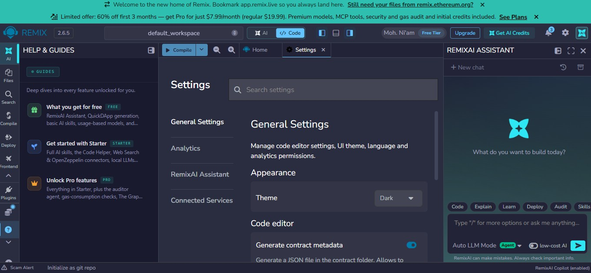
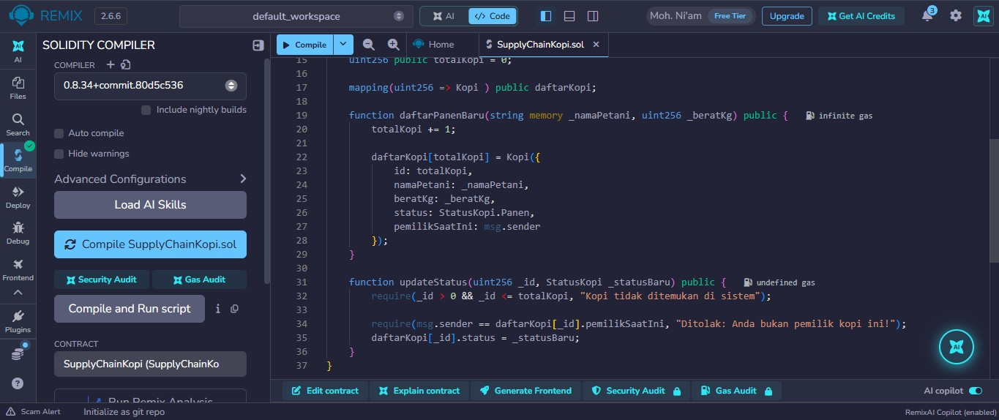
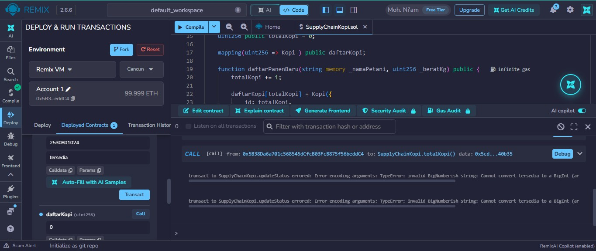
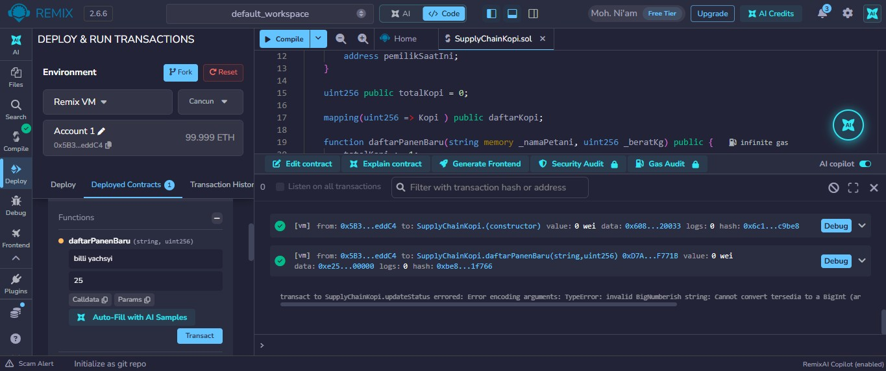

# praktikum 6: Membuat Smart contract dengan Solidity di Remix #

##Tujuan Pembelajaran
Setelah menyelesaikan  praktikum ini, mahasiswa diharapkan mampu :
1. Memahami konsep dasar dari smart contact pada blockchain.
2. Menggunakan platform remix untuk menulis, mengompilasi, dan men-deploy smart contract berbasis solidity.
3. Mengimplementasikan fungsionalitas dasar smart contract yang melibatkan state variabel dan fungsi.
4. Melakukan interaksi dengan smart contract yang sudah terd-deploy melalui remix.

### Proses Praktikum ###

1. Buka [Remix IDE](https://remix.ethereum.org/) login via Gmail, bukti:

2. Buat file baru di files dengan nama file SupplyChainKopi.sol 
isi coding sesuain dengan modul.

3. Lakukan kompilasi dengan menekan tombol di samping kiri SupplyChainKopi.sol

4. Deploy smart contract ke blockchain

