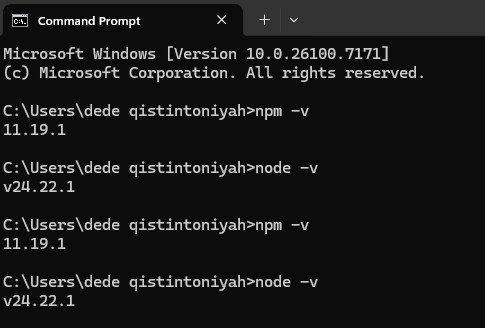
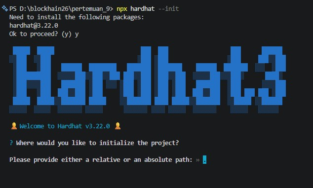
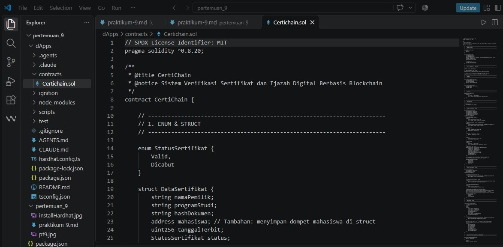
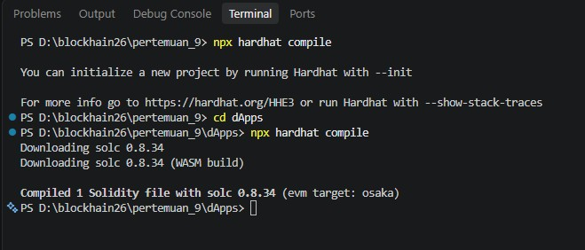
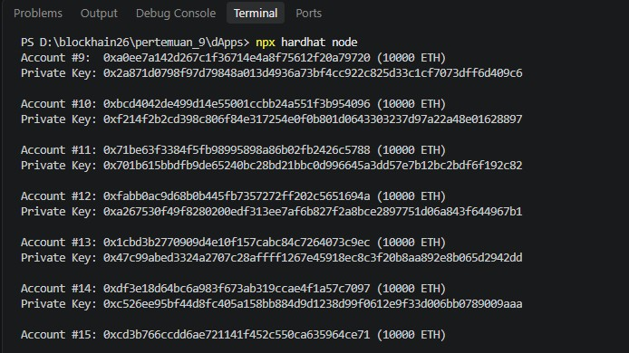
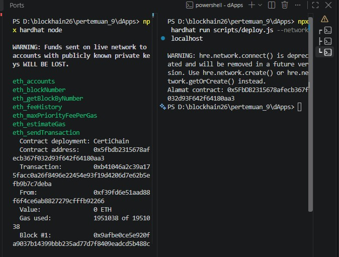
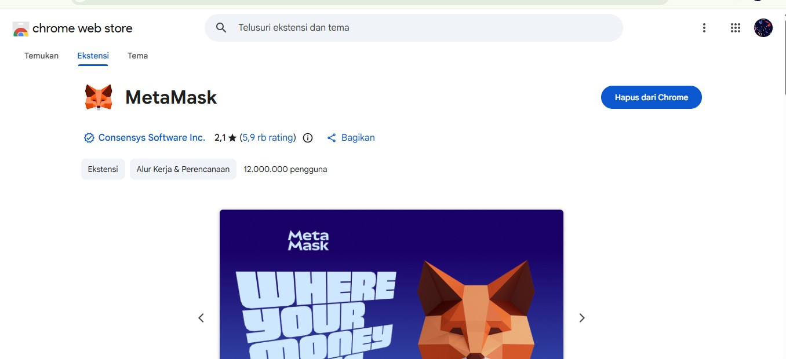
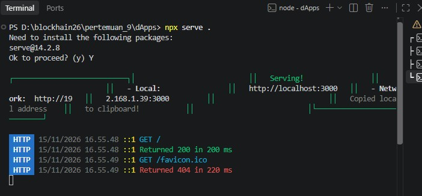
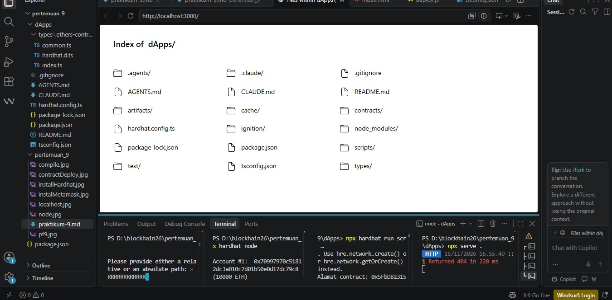
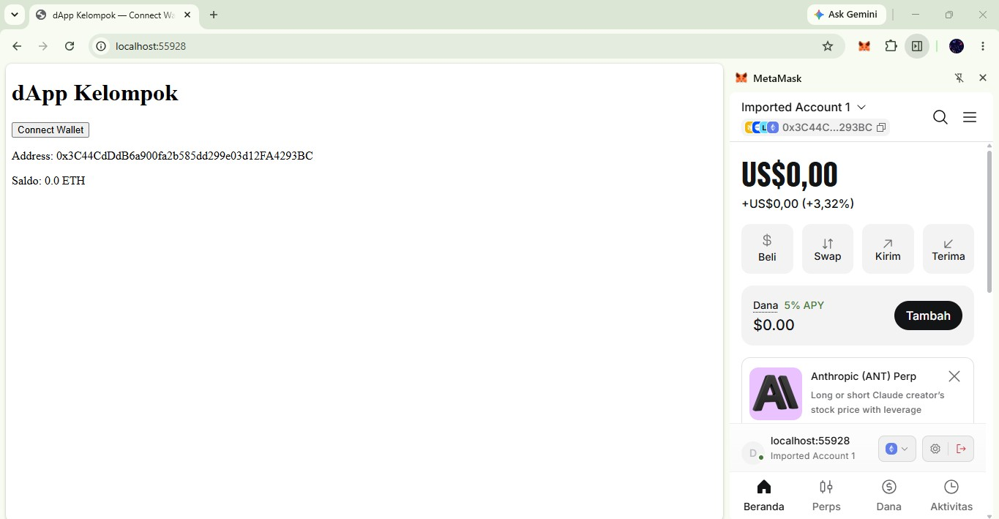

# INTEGRASI FRONT END DAN WEB3 #

## Langkah Praktikum ##

1. Cek Instalasi Node dan NPM (node -v, npm -v)
2. Jika belum tersedia instal via https://nodejs.org/en/download
3. bukti node Js dan NPM

4. Buat folder baru nama dApps
5. Open Terminal dan CD ke dalam folder tersebut
   '''Bash
   mkdir dApps
   cd pertemuan_9/dApps
6. Inisiasi 
npm init -y
7. Install framwork hardhat
npm install --save-dev hardhat

8. Menjalankan Hardhat (npx hardhat --init )

9. Unduh dan tempatkan File snart contract yang sudah dibuat di Remix ke folder Contracts

10. Compile Projek dApps dengan perintah (npx hardhat compile)

11. Menjalankan Node untuk mendapatkan aktor dan address (npx hardhat -->node)

12. Membuat file deploy.js

13. Deploy node ke Local

14. Membuat file index.html 
15. install Extension MetaMask

16. Login / Create Akun Via Oauth GMail
17. Create Custom Network dengan nama Hardhat Local
18. Import Custom account via private key (Private key di dapat di terminal VScode)
19. Jalankan Index.html (npx serve .)

20. Hasil sudah Konek

